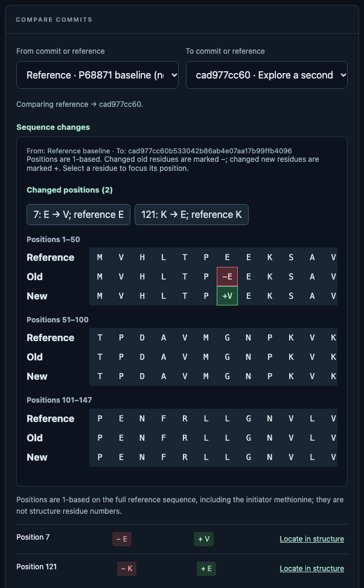
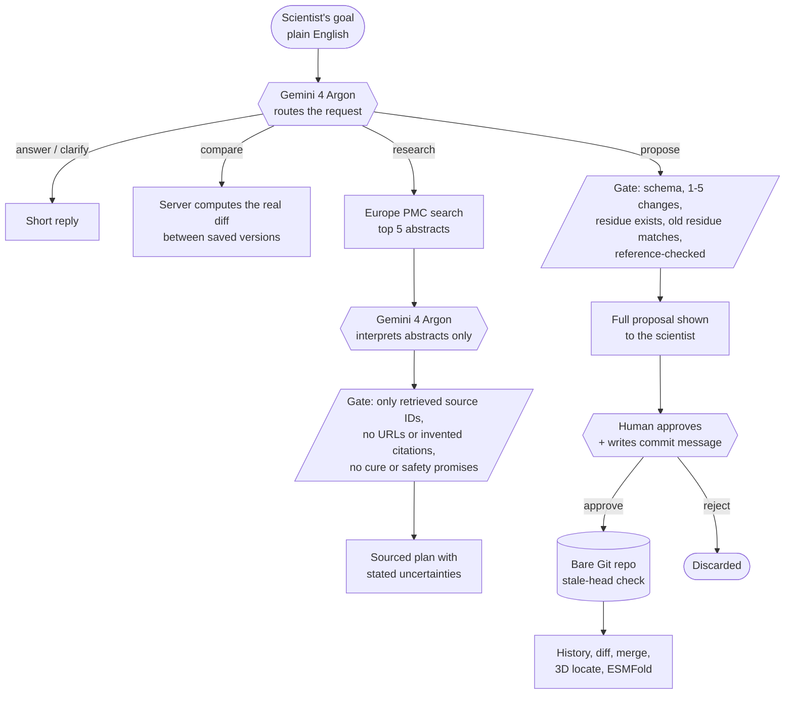

<div align="center">

# EditVerse

### Git for protein hypotheses. An agent proposes, a gate verifies, a scientist signs off.

Check it out at: https://dheer309--editverse-hosted-serve.us-east.modal.run/

**An agent-assisted research workspace for human β-globin (*HBB*), the gene behind sickle cell disease.**
Every AI-proposed sequence change is checked in code, traced to real sources, versioned like source code, and committed only when a human approves it.

[](BIOTECH_BRIEF.md)
[](#models-and-tools-exact-identifiers)
[](#evidence-and-evaluation)
[](#run-it-in-two-minutes)
[](#responsible-design-risks-and-mitigations)


<sub>The built-in 3D viewer: experimental RCSB structure 2HBS, rendered locally with 3Dmol.js. Edits are marked on deposited coordinates and never passed off as predicted structures.</sub>

</div>

---

## Run it in one line

```sh
git clone -b proposed-new-app https://github.com/itsfaraazak/UCLAgentverse26.git && cd UCLAgentverse26 && ./run.sh
```

That checks your machine, asks for your Gemini key (hidden input, optional), starts the app and opens **http://127.0.0.1:8000**. Needs only Python 3.9+ and Git. Nothing to `pip install`. More options in [Run it in two minutes](#run-it-in-two-minutes).

---

## The problem, and who it is for

> Bringing a new treatment to patients takes over a decade and billions of pounds, and most candidates fail along the way. *(Biotech track brief)*

**User (a persona we designed for):** a computational biologist in an early-stage hemoglobinopathy group, proposing and triaging *HBB* variants (the **Design** step of design-build-test-learn).

**The bottleneck:** hypotheses live in notebooks and chat windows. An LLM will happily suggest "mutate position 7 to V", but nothing records *why*, nothing separates literature from speculation, nobody can diff, branch or roll back an idea, and a confident paragraph looks the same as a checked fact. The scientist loses time re-deriving provenance and, worse, can't tell which suggestions deserve a wet-lab slot.

**EditVerse makes the hypothesis loop fast *and* auditable.** The agent does the legwork (literature search, mapping a plain-English goal to concrete residue changes). The software enforces the rules. The scientist keeps the decision.

**Plausible next step to real use:** point the same loop at a lab's own (non-patient) variant shortlist, add experimental assay results as a third kind of commit, and hand the version history to the wet-lab team as the reasoning record. See [Limits and roadmap](#limits-and-roadmap).

---

## Judge's cheat-sheet

The Biotech track scores five things ([brief](BIOTECH_BRIEF.md)). Here is where each one lives.

| Criterion | What we built | Where to look |
| --- | --- | --- |
| **Uniqueness of idea** | Not a literature chatbot. A *version-controlled* hypothesis workspace: branch, diff, merge-with-conflicts and roll back protein edits, with the agent as one contributor among several. | [History view](#what-you-can-do) |
| **Real-world need** | One bottleneck, one named user: provenance and reviewability of AI-suggested *HBB* variants. | [The problem](#the-problem-and-who-it-is-for) |
| **Science, data and evaluation** | Fixed UniProt reference, RCSB experimental structures, live Europe PMC abstracts, optional ESMFold. Every dataset referenced with its licence. Honest evaluation, including what we have *not* measured. | [Data](#data-and-licences), [Evidence](#evidence-and-evaluation) |
| **Agent design and live demo** | A real multi-step agent: it *chooses* between answering, clarifying, searching, comparing and proposing. It takes any new question a judge types. | [How the agent works](#how-the-agent-works), [Demo script](#the-3-minute-demo) |
| **Security and responsible design** | Named risks, each with a mitigation that exists in code, and a human approval gate on every commit. | [Responsible design](#responsible-design-risks-and-mitigations) |

---

## What you can do

<table>
<tr>
<td width="50%" valign="top">

### 1. Talk to a research agent
Describe a goal in plain English: *"Which residue changes are linked to sickle cell, and what does the literature say about position 7?"*

The agent picks its own next step: **answer**, **ask a clarifying question**, **search Europe PMC**, **compare your latest versions**, or **propose up to five substitutions**.

### 2. Review, then approve
A proposal appears in full, with its base version, exact residue changes and limitations. Nothing is saved until you add a commit message and approve.

### 3. Version it like code
Branches, commit history, restore (as a *new* commit, never a rewrite) and merge with explicit conflict resolution. Backed by a real bare Git repository.

</td>
<td width="50%" valign="top">

### 4. See it
Residue-level diffs against the fixed UniProt P68871 reference or any two commits. Select a changed site to **locate it in the 3D structure** (2HHB hemoglobin A vs 2HBS hemoglobin S).

### 5. Predict on demand
Send an exact saved sequence (or two, side by side) to **ESMFold** for a single-chain computational prediction. Opt-in per click; clearly labelled as unvalidated.

### 6. Or edit by hand
Manual substitutions go through the same validation and the same history.

</td>
</tr>
</table>

<div align="center">


<sub>History view: the reference baseline vs a committed version. Old residues in red, new in green, each with a "Locate in structure" link. Screenshot from a real local run with two seeded commits (E7V and K121E).</sub>
</div>

---

## How the agent works

One user message triggers a bounded, multi-step pipeline. The model never touches storage; it can only return JSON that deterministic code accepts or rejects.



| Agent action | What happens | Implementation |
| --- | --- | --- |
| `answer` / `clarify` | Short reply or one useful question. No search, no edit. | [`backend/goal_agent.py`](backend/goal_agent.py) |
| `compare` | The *application* computes the diff of the latest version against its parent. The model never narrates a diff it invented. | [`goal_agent.py`](backend/goal_agent.py), [`git_history.py`](backend/git_history.py) |
| `research` | Model supplies 1-3 plain keywords. We query Europe PMC (`HBB AND (...)`), retrieve up to 5 abstracts, then ask the model to interpret **only** those, citing only their IDs. | [`goal_agent.py`](backend/goal_agent.py) |
| `propose` | Up to 5 substitutions on the current sequence, with an `expected_old` guard: if the model's belief about the current residue is wrong, the proposal is refused and the user is asked to confirm. | [`goal_agent.py`](backend/goal_agent.py), [`hbb_sequence.py`](backend/hbb_sequence.py) |
| `commit` | Requires an unguessable single-use token (15-minute expiry, capped pending proposals), literal `approved: true`, and an unchanged branch head. | [`backend/server.py`](backend/server.py), [`agent_plan.py`](backend/agent_plan.py) |

---

## The verification loop

This is the core of EditVerse. **Model output is untrusted input.** Between the model and your data sits a stack of deterministic checks, and a human at the end.

| # | Gate | What it catches | Enforced by |
| --- | --- | --- | --- |
| 1 | **Schema-constrained output** (`responseSchema` + exact-key checks, duplicate JSON keys rejected, 64 KB cap, `finishReason == STOP`) | Malformed, truncated, oversized or ambiguous responses | `_model`, `_unique_object` |
| 2 | **Reference check** against UniProtKB **P68871** (147 aa, v2) | Positions out of range, wrong "reference" residue, no-op substitutions, non-standard amino acids | [`hbb_sequence.make_state`](backend/hbb_sequence.py) |
| 3 | **`expected_old` guard** | Model and user disagreeing about what is *currently* at a position | `goal_agent.respond` |
| 4 | **Source gate** | Citations the model made up: every cited ID must be among the abstracts we actually retrieved; URLs, `PMID:`/`DOI:` strings in generated prose are rejected; unattributed prose is replaced with "no sourced interpretation" | `_strings`, `_search` |
| 5 | **Claim gate** | "Cures", "proven safe", "guarantees efficacy" are rejected outright | `_CLINICAL_PROMISE` |
| 6 | **Input hardening** | Prompt injection via the search path: queries limited to `[A-Za-z0-9 -]`; abstract HTML stripped; conversation and retrieved text treated as *data* in every system prompt | `_search`, `_text` |
| 7 | **Stale-head rejection** | Silent overwrites: the commit carries the head it was based on; a changed branch fails instead of clobbering | [`git_history.py`](backend/git_history.py) |
| 8 | **Human approval gate** | Everything else. The agent has *no* code path that commits without `approved: true` from the user for that exact proposal. | `agent_commit` |
| 9 | **Honest labelling** | Overclaiming. Structures are labelled "experimental reference, not predictions of your edits"; ESMFold output "unvalidated single-chain prediction"; model text "unverified". | UI + API payloads |

**What verification does and does not mean here.** Gates 1-7 prove a proposal is *well-formed, traceable and consistent with the reference*. They do **not** prove a substitution is biologically beneficial. Nothing in this repository does, and we say so in the UI. The human gate exists because that judgement belongs to a scientist.

---

## Models and tools (exact identifiers)

| Job | Identifier | Used for |
| --- | --- | --- |
| Lead reasoning and routing | **`gemini-4-argon`** (Gemini API `generateContent`, `v1beta`, JSON-schema-constrained output) | Routing the request, mapping goals to residue changes, interpreting retrieved abstracts. Set once in [`backend/agent.py`](backend/agent.py) as `MODEL` and shared by every agent module. |
| Protein structure prediction (default) | ESMFold via the [ESM Metagenomic Atlas](https://esmatlas.com/) API | Opt-in single-chain prediction of a saved sequence |
| Protein structure prediction (self-hosted option) | **`facebook/esmfold_v1`**, pinned to revision `75a3841ee059df2bf4d56688166c8fb459ddd97a`, on [Modal](https://modal.com) (A100-40GB) | Same job, your own GPU worker. [Setup](esmfold_modal/README.md) |
| Literature | [Europe PMC REST API](https://europepmc.org/RestfulWebService) | Abstract retrieval for the research action |
| Variant provenance | [NCBI ClinVar](https://www.ncbi.nlm.nih.gov/clinvar/) via E-utilities (`VCV000015333`) | Optional published HbS (E7V) example, identity and provenance validated before use |
| 3D rendering | [3Dmol.js](https://3dmol.org/) 2.5.3, bundled | Local structure viewer; no CDN, no live RCSB calls |

All Gemini calls are made server-side. The API key is read from the environment and never reaches the browser.

---

## Evidence and evaluation

We would rather show a small honest result than a big flattering one.

**Automated tests (run on Python 3.14.6 and Node 26.4.0):**

```text
Python:  166 tests, OK     (backend, HTTP boundaries, real Git objects and diffs, mocked provider failures)
Node:    9 suites, all OK  (3D viewer mapping, diff rendering, agent workspace, prediction compare)
```

**Reproducible gate evaluation** (`python evaluation.py`). Ten hand-authored synthetic artifacts, labelled independently from the code, exercise the artifact-check rules (every claim needs a reference; claim text must be unique). Compared against a naive baseline that accepts any non-empty artifact:

| Method | TP | TN | FP | FN | Correct |
| --- | ---: | ---: | ---: | ---: | ---: |
| Structural checks | 4 | 6 | 0 | 0 | **10/10** |
| Naive "has any claim" baseline | 4 | 1 | 5 | 0 | 5/10 |

> **Read this honestly.** These cases are *synthetic* and were built to exercise the rules, so 10/10 shows the rules are implemented as specified, not that the agent is accurate. The checks establish a *structural* property (claims reference something), not that a claim is true. Synthetic data here is labelled as such and is never presented as real-world performance.

**What we have not done:** no clinician or domain-expert validation, no head-to-head study against a scientist's manual workflow, no live-model benchmark, no independent source verification. The JS viewer tests use mocks, which do not replace a real WebGL browser check. The screenshots above come from a real headless-Chrome render of the running app.

---

## Responsible design: risks and mitigations

Per the track brief: *named risks, a mitigation for each, and a human signs off key decisions.*

| Risk | Mitigation (in this repo) | Human in the loop? |
| --- | --- | --- |
| **Hallucinated science or fabricated citations** | Source gate: only retrieved IDs may be cited, generated URLs/DOIs rejected, claims labelled unverified. | Scientist inspects the linked abstracts |
| **Agent silently edits the research record** | Agent has no write path; commit needs single-use token + explicit approval + non-stale head. | **Yes, every commit** |
| **Overclaiming a variant "works" or is safe** | Clinical-promise filter; every proposal ships with limitations; UI repeats "not a measured or predicted effect". | Yes |
| **Misreading experimental vs predicted structures** | 3D view uses *deposited* PDB coordinates only (2HHB vs 2HBS are independent experiments, not before/after). ESMFold results are separate, labelled and opt-in. | Yes |
| **Patient or sensitive data leaks to a third party** | Public data only. Only the conversation and current sequence go to Google; **notes and history never leave the machine**. Clear disclosure at the send button. Users are told not to enter patient data. | Yes (explicit send action) |
| **Prompt injection through user text or abstracts** | Inputs treated as data in every system prompt; keyword-only search queries; HTML-stripped abstracts; strict output schema; nothing the model returns is executed. *Reduces* the risk; we do not claim it is eliminated. | Yes (approval gate backstops it) |
| **Lost or overwritten work** | Git-backed history; stale commits rejected; restore creates a *new* commit; merges block on conflicting residues or divergent notes. | Yes |
| **API key exposure** | Key only in the server environment; `.env*` git-ignored; never sent to the browser. | n/a |
| **Local attack surface** | Binds to `127.0.0.1` only; non-loopback `Host` rejected (DNS-rebinding), cross-origin browser writes rejected, request bodies capped, CSP and `X-Frame-Options: DENY` set. | n/a |
| **Surprise GPU bills** | Modal prediction is opt-in per click; automatic mode needs an explicit env flag. | Yes |
| **Dual-use / wet-lab misuse** | System prompts forbid lab protocols and procedural editing instructions, and substitutions are in-silico *protein* strings, not genome edits. (Prompt-level control, so the human gate is the backstop.) | Yes |

Full operational and security notes: [SECURITY.md](SECURITY.md).

---

## Data and licences

| Source | Used for | Licence / terms |
| --- | --- | --- |
| [UniProtKB P68871](https://www.uniprot.org/uniprotkb/P68871/entry) (HBB_HUMAN, sequence v2) | Fixed 147-residue reference sequence | CC BY 4.0 |
| [RCSB PDB 2HHB](https://www.rcsb.org/structure/2HHB) (Fermi *et al.*, 1984) and [2HBS](https://www.rcsb.org/structure/2HBS) (Harrington *et al.*, 1997) | 3D reference structures, bundled unmodified in [`web/structures/`](web/structures) | PDB archive data is CC0 1.0 |
| [Europe PMC](https://europepmc.org/) | Live abstract retrieval; **not** redistributed or stored | [Europe PMC terms](https://europepmc.org/Copyright) |
| [NCBI ClinVar](https://www.ncbi.nlm.nih.gov/clinvar/variation/15333/) | Optional HbS provenance lookup | [NCBI policies](https://www.ncbi.nlm.nih.gov/home/about/policies/) |
| [3Dmol.js](https://3dmol.org/) 2.5.3 | Molecular viewer, bundled with its licence | BSD-3-Clause ([`web/vendor/3Dmol-LICENSE.txt`](web/vendor/3Dmol-LICENSE.txt)) |
| [`facebook/esmfold_v1`](https://huggingface.co/facebook/esmfold_v1) | Optional prediction model | See the model card |

**No real patient data anywhere.** All sequences are public reference sequences or user-typed hypothetical substitutions. File hashes and citations for the bundled structures are in [`web/MOLECULE.md`](web/MOLECULE.md). The test fixtures and the evaluation set are synthetic and labelled as such.

---

## Run it in two minutes

**Requirements:** Python 3.9+, Git, and a WebGL-capable browser (Chrome, Edge, Firefox, Safari). The backend uses only the Python standard library: **no `pip install`, no `npm install`, no build step.** Node is only needed to run the JS tests.

### Fastest: the setup script

```sh
git clone -b proposed-new-app https://github.com/itsfaraazak/UCLAgentverse26.git
cd UCLAgentverse26
./run.sh
```

[`run.sh`](run.sh) does everything for you:

1. Checks Python 3.9+ and Git, with a clear message and download link if either is missing.
2. Finds your Gemini key, in this order: your shell (`GEMINI_API_KEY`), a local `.env` file, or a hidden prompt (press Enter to skip). It can save the key to `.env` (permissions `600`, git-ignored) if you say yes. The key is never printed or logged.
3. Picks a free port (8000, or the next free one if an older server is still running).
4. Starts the server, waits until it answers, and opens your browser.

| Command | What it does |
| --- | --- |
| `./run.sh` | Check, configure and start the app |
| `./run.sh --no-open` | Same, without opening a browser |
| `./run.sh --test` | Run the full Python and JS test suites plus the evaluation |
| `PORT=9000 ./run.sh` | Start on a specific port |
| `./run.sh --help` | Show usage |

Press **Ctrl+C** to stop. On Windows, run it from WSL, or use the manual steps below.

### Manual (no script)

```sh
git clone -b proposed-new-app https://github.com/itsfaraazak/UCLAgentverse26.git
cd UCLAgentverse26
export GEMINI_API_KEY='your-key-here'   # your own key; stays in your shell
python3 backend/server.py
```

Then open **http://127.0.0.1:8000**.

### Good to know

- **Get a key** at [Google AI Studio](https://aistudio.google.com/). At the hackathon, claim your onsite credits at the Google DeepMind booth.
- **Without a key**, everything except the agent works (manual edits, history, diff, merge, 3D, ESMFold). Agent requests return a clear "Gemini is not configured" message. There is deliberately no scripted fake fallback.
- **Never commit a key.** `.env` files are git-ignored; the key is read only by the server process and never reaches the browser.
- **The server is local-only.** It binds to `127.0.0.1` and has no authentication. Do not expose it to a network ([SECURITY.md](SECURITY.md)).
- **Your data stays local.** Versions live in `research-notes.git/` and `store.sqlite3` in the project folder (both git-ignored). Delete them to start fresh.
- **Troubleshooting:** if the page shows old behaviour after a code change, stop any older server process and re-run. If the 3D viewer is blank, check that WebGL is enabled in your browser.

### Configuration

| Variable | Default | Purpose |
| --- | --- | --- |
| `GEMINI_API_KEY` | unset | Enables the agent. Server-side only. |
| `PORT` | `8000` | Loopback port (`python3 backend/server.py` accepts `0` for an OS-assigned port; `run.sh` needs a real port) |
| `STORE_DB_PATH` | `store.sqlite3` | SQLite workspace file |
| `GIT_HISTORY_PATH` | `research-notes.git` | App-owned bare Git repo for versions. Do **not** point at an existing repository |
| `EDITVERSE_FOLD_PROVIDER` | `atlas` | `atlas` (ESM Atlas) or `modal` (your worker) |
| `EDITVERSE_FOLD_AUTOMATIC` | unset | `1` = auto-predict with Modal (**can incur charges**) |

**Run the checks:**

```sh
./run.sh --test
```

Or by hand:

```sh
STORE_DB_PATH=:memory: python3 -m unittest discover -s tests   # ~100 s
for t in tests/test_*.js; do node "$t"; done
python3 evaluation.py
```

---

## The 3-minute demo

Opens on working software, triggers the agent and verification loop live, and takes a judge's own question.

| Time | Do this | What the judges see |
| --- | --- | --- |
| 0:00 | Open the app. State the user and bottleneck in one sentence. | A live workspace, no slides |
| 0:20 | Ask the agent: *"What does the literature say about the sickle cell substitution at position 7?"* | Agent chooses **research**, shows retrieved Europe PMC sources, a plan, and **stated uncertainties** |
| 1:00 | Ask: *"Propose the sickle cell substitution at position 7."* | Agent chooses **propose**; full proposal appears, unsaved |
| 1:20 | Approve with a commit message. | Single-use token, new Git commit, instant history entry |
| 1:40 | Open **History**, compare to the P68871 reference, click **Locate in structure**. | Red/green residue diff; site highlighted on 2HHB vs 2HBS |
| 2:10 | **Hand the keyboard to a judge** to type any new HBB question. Create a branch, make a conflicting edit, preview the merge. | Real agent handling unseen input; conflict **blocked**, not silently merged |
| 2:40 | Click **Predict with ESMFold** (or show the pre-run result). | Labelled, opt-in, unvalidated prediction |
| 2:50 | Close on the approval gate: *the agent cannot commit without you.* | The responsible-design story in one sentence |

> Keep a local screen recording as a Wi-Fi backup: the agent, Europe PMC and ESMFold all need the network.

---

## Repository map

```text
backend/
  server.py              Loopback HTTP API + static files, security headers
  goal_agent.py          The agent: route -> research / compare / propose (used by the UI)
  agent.py               Gemini wrapper, shared MODEL, bounded schema validation
  agent_plan.py          Approved commit of a model-proposed plan
  hbb_sequence.py        Fixed UniProt P68871 reference + substitution validation
  git_history.py         Bare-Git versioning, branches, diff, merge, stale-head checks
  structure_prediction.py  ESMFold client + PDB response validation
  known_variant.py       ClinVar-verified HbS (E7V) example (API-only)
  agent_explain.py       Opt-in explanation of a comparison (API-only)
web/                     Static UI, 3Dmol viewer, bundled structures (no build step)
esmfold_modal/           Optional self-hosted ESMFold worker for Modal
tests/                   Python + JS test suites
evaluation.py            Reproducible gate evaluation
```

Some modules (`agent_explain.py`, `known_variant.py`, the one-shot `POST /api/agent/propose`, and the earlier synthetic review pipeline behind `/api/run` and `/api/review`) are retained with their tests but are **not part of the current interface**; they do not represent the live workflow.

---

## Limits and roadmap

**Limits (stated plainly, because judges and scientists should hear them from us):**

- A sequence substitution here is a **hypothetical string edit**. It is not a genome edit, a treatment, or evidence of function.
- The agent's literature search is a bounded abstract search, not a systematic review. Abstract-level evidence cannot support claims about one exact substitution.
- ESMFold predictions are single-chain, unvalidated, and not a hemoglobin tetramer. The hosted service has no availability guarantee.
- No authentication, encryption or network-deployment protection. It is a local prototype ([SECURITY.md](SECURITY.md)).
- No clinical, expert or real-world performance evaluation has been done.

**Roadmap (what would make it real):**

1. Add assay results as a first-class commit type, so predictions and measurements sit side by side in one history.
2. Evaluate the agent against a scientist's manual triage on a labelled public variant set (ClinVar, gnomAD), with a proper baseline.
3. Pull full-text evidence (OpenAlex, bioRxiv) and per-claim support checking.
4. Authentication, signed commits and reviewer roles, so the sign-off is attributable.
5. Extend beyond *HBB* to any UniProt entry.

---

## Documentation

| Doc | Contents |
| --- | --- |
| [SECURITY.md](SECURITY.md) | Local operation, data flows, hardening and its limits |
| [web/MOLECULE.md](web/MOLECULE.md) | 3D viewer API, residue-numbering mapping, structure provenance and hashes |
| [web/AGENT_WORKSPACE.md](web/AGENT_WORKSPACE.md) | Agent panel integration contract |
| [esmfold_modal/README.md](esmfold_modal/README.md) | Self-hosted ESMFold: cost, privacy, deployment |
| [backend/SEQUENCE_API.md](backend/SEQUENCE_API.md) | Sequence versioning API |
| [BIOTECH_BRIEF.md](BIOTECH_BRIEF.md) | The AgentVerse 2026 Biotech track brief we built against |

<div align="center">

<sub>Built for **AgentVerse 2026** (7-8 November, UCL AI Society, with Google DeepMind). Application code was written during the event (open-source libraries and public datasets excepted); the commit history is public.<br>
Research prototype. Not a clinical product, genome editor, or experimental design tool. Do not enter patient or sensitive information.</sub>

</div>
