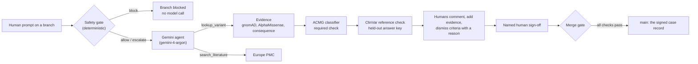

# SigmaFold Workbench

**Version control where clinical scientists and AI agents interpret genetic variants together.**

Type any variant, such as `rs334`, `BRCA1 c.5266dupC` or `CFTR p.Phe508del`. A Gemini agent fetches real public evidence, a deterministic ACMG rule engine classifies the variant as a required check, a ClinVar reference check flags disagreement, and a named human signs off before anything reaches the case record. Every step (prompt, tool result, classification, comment, sign-off, merge) is an attributed, content-addressed delta on an append-only branch history, so a scientist can see exactly who concluded what, from which evidence.

Built for UCL AgentVerse 2026, Biotech track. One-page write-up: [`docs/WRITEUP.md`](./docs/WRITEUP.md). Evaluation: [`docs/EVALUATION.md`](./docs/EVALUATION.md). Pitch and demo script: [`docs/PITCH.md`](./docs/PITCH.md).

## The problem

Clinical genomics labs sequence far more than they can interpret. For each variant, a clinical scientist gathers population frequency, computational predictions, prior classifications and literature, then applies the ACMG/AMP criteria by hand. The reasoning lives in spreadsheets and email threads, and when an AI tool is involved it's rarely clear what the model said versus what the human decided.

SigmaFold gives that work the structure software teams already rely on: branches, required checks, review and a protected main branch.

## How it works



- **The agent can't skip the checks.** Whenever the model fetches evidence, the classifier and ClinVar comparison run automatically and are recorded as deterministic deltas.
- **ClinVar is the answer key, not an input.** The classifier never sees it. It is revealed afterwards, and a major disagreement (one call is P/LP and the other is not) blocks the merge until a human signs off with a rationale.
- **Only humans make key decisions.** Agents can recommend; only a named human can dismiss a criterion, add family evidence, sign off or merge. A newer classification makes an older sign-off stale.
- **The safety gate runs before any model call.** Interpreting an observed variant is in scope for any gene. Edit proposals go through the repository's biosafety policy (`src/lib/safety/policy.ts`, unchanged and guarded by CI): disrupting a tumour suppressor is refused, refused text is never stored, and construct-design requests (guides, primers, protocols) are blocked.
- **Demos survive a bad network.** If the model fails or times out, a deterministic pipeline finishes the run and says so. Evidence for the demo variants ships as a cached snapshot, labelled as cached in the UI.

## Evaluation

On 200 real ClinVar variants with 2+ star expert consensus (100 P/LP, 100 B/LB, 157 genes), with ClinVar hidden from every method:

| Method | Coverage | Accuracy when it called | False reassurance (pathogenic called benign) |
|---|---|---|---|
| SigmaFold classifier | 15.5% | 100% (31/31) | **0** |
| AlphaMissense alone | 58.5% | 93.2% (109/117) | **5** |
| Population frequency alone | 11.5% | 100% (23/23) | 0 |

SigmaFold is conservative by design: it implements 8 of the ~28 ACMG criteria and leaves most variants as Uncertain Significance, routing them to a human, rather than making confident wrong calls. Full method, circularity caveats and the false-reassurance cases are in [`docs/EVALUATION.md`](./docs/EVALUATION.md) and at `/evaluation` in the app.

## Data and licences

Real public reference data only. No patient data is used anywhere.

| Source | Used for | Licence |
|---|---|---|
| [MyVariant.info](https://myvariant.info/terms/) | Aggregated variant annotation API | Free public API; each source keeps its terms |
| [gnomAD](https://gnomad.broadinstitute.org/terms) v2.1.1 | Population allele frequency | CC0 1.0 |
| [AlphaMissense](https://github.com/google-deepmind/alphamissense#alphamissense-predictions-license) via dbNSFP 4.8a | Missense pathogenicity score | CC BY 4.0 (DeepMind); dbNSFP compilation academic use |
| [ClinVar](https://www.ncbi.nlm.nih.gov/home/about/policies/) / dbSNP | Held-out reference classification, rsIDs | NCBI: no restrictions (US Government work) |
| [Europe PMC](https://europepmc.org/Copyright) | Literature titles and links | Free API; article content under publisher copyright |
| snpEff via MyVariant.info | Consequence annotation | LGPLv3 (v4.3k) |

Each value in the UI carries its source, licence and retrieval time. See [`src/lib/evidence/LICENCES.md`](./src/lib/evidence/LICENCES.md).

## Run it

```bash
pnpm install
cp .env.example .env.local   # add GEMINI_API_KEY; without it the deterministic pipeline runs
pnpm build && pnpm start     # http://localhost:3000
```

```bash
pnpm test        # unit and component tests
pnpm eval        # re-score the benchmark offline; writes docs/EVALUATION.md
pnpm lint && pnpm typecheck
```

Pages: `/` workbench · `/evaluation` benchmark results · `/classic` the earlier genome version-control prototype (`/ide`, `/bench`, `/graph` are its variants).

## Code map

```
src/lib/evidence    MyVariant.info / Europe PMC clients, normalisation, cache, ACMG mapping, ClinVar comparison
src/lib/workbench   append-only delta store, safety gate, Gemini function-calling agent, fallback, merge gate
src/lib/acmg        deterministic ACMG/AMP points engine (Tavtigian et al. 2018)
src/lib/safety      biosafety screening policy (never edited by agents; CI-guarded)
src/lib/eval        benchmark metrics and baselines
src/app/api/workbench  route handlers (NDJSON streaming for agent runs)
src/components/workbench  the UI
```

## Limits

- **Not a clinical tool.** The classifier implements 8 of ~28 ACMG/AMP criteria. PVS1 uses a consequence plus a curated gene list, with no NMD or last-exon analysis. PS1 is not assessed, because it would need ClinVar.
- **Computational evidence is limited.** AlphaMissense is used only as supporting evidence and only scores missense variants. It is known to under-call some mechanisms, such as the sickle-cell allele (rs334), which is exactly why the reference check and human sign-off exist.
- **The ClinVar safety net needs a ClinVar record.** For a novel variant there is nothing to disagree with, and the Uncertain Significance call itself is the signal for a human.
- **Identity is self-declared.** Name and role are typed in, with no authentication in this prototype. State lives in one server process (`.data/workbench.json`).
- **Edits stay at sequence level.** Edit proposals are sequence-diff descriptions only. No guides, primers, vectors or protocols are produced, by policy.
