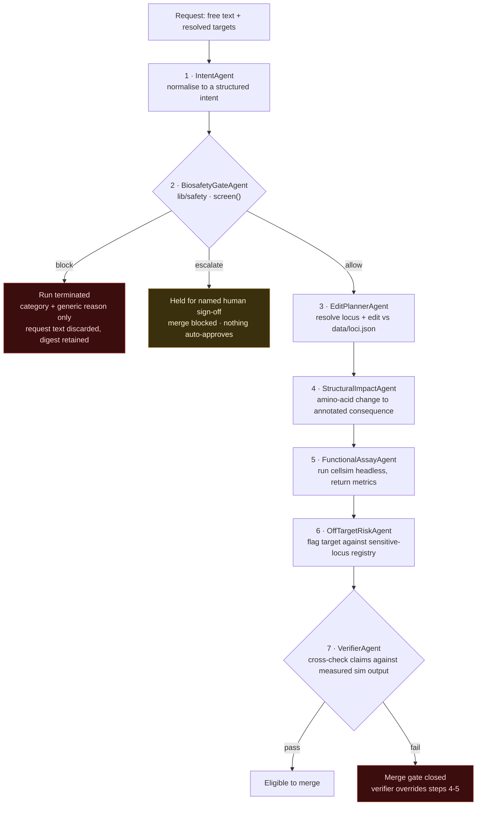
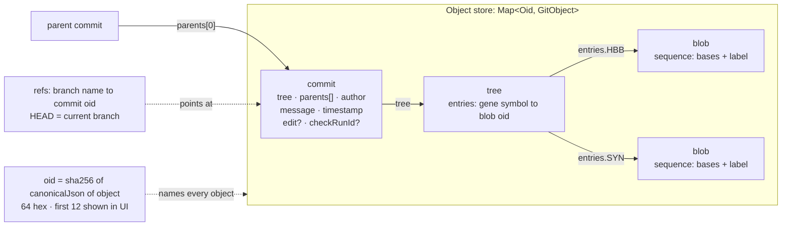

# SigmaFold — architecture

Companion to [`SPEC.md`](../SPEC.md), which is the contract. This document describes how the
pieces fit together and is explicit about which parts are verified in code in this checkout and
which are specified but not yet merged here.

**Verification status at the time of writing.** Present and tested in this checkout:
`src/lib/genome/`, `src/lib/vcs/`, `src/lib/safety/`, `src/data/loci.json`.
Specified in SPEC §4.3–§4.4 and implemented on the `core/agents-cellsim` branch, **not in this
checkout**: `src/lib/agents/`, `src/lib/cellsim/`. Everything in `src/components/` beyond the
generated shadcn/ui primitives, and all three UI surfaces, live on the variant branches.
Statements about those are marked **planned** throughout.

---

## 1. Module graph

```
src/
  app/                  Next.js 16 App Router — composition only
  components/
    ui/                 shadcn/ui primitives over Base UI (generated)
    …                   feature components (planned, on the variant branches)
  lib/                  ← pure, framework-free, unit-testable
    genome/             sequence model, genetic code, variants, codon diff
    vcs/                content-addressed object store, branches, three-way merge
    safety/             screening policy — the gate
    agents/             delta DAG + seven-agent pipeline      (planned here)
    cellsim/            seeded headless particle simulation   (planned here)
  data/
    loci.json           curated reference + annotation fixtures
```

Dependency direction, as it exists today:

```
data/loci.json  →  lib/genome  →  lib/vcs
                        ↑              ↑
                   lib/safety     (planned) lib/agents → lib/cellsim
                                             ↓
                                      app/ + components/
```

`lib/vcs/types.ts` imports `Sequence` and `Variant` from `lib/genome`; nothing in `lib/genome`
imports from `lib/vcs`. `lib/safety` imports nothing from the other domain modules at all — it
takes free text plus resolved gene symbols and returns a verdict. The arrows never run
backwards: no domain module imports from `app/` or `components/`.

### Why `lib/` is pure and framework-free

SPEC §8 requires it, and three concrete properties fall out:

- **The simulation is callable from a non-UI caller.** The functional-assay agent needs the same
  numbers the canvas shows. If the physics lived in a React component, the agent would need a
  second implementation — and a second implementation is a second set of numbers to disagree
  about. A headless `step()` means the audit trail cites the same run the audience watched.
- **The domain layer is unit-testable in isolation.** `vitest.config.mts` runs the whole suite
  in the `node` environment; component tests have to opt into jsdom with a per-file
  `// @vitest-environment jsdom` pragma. A React import in `lib/` would break that default.
- **Three UI variants, one core.** SPEC §6 asks for three genuinely different surfaces over the
  same engine. That is only cheap if the engine has no opinion about rendering.

Supporting constraints, also from SPEC §8: TypeScript strict, no `any` in `lib/`, no `!`
non-null assertions. The style this produces is visible in `lib/vcs/repo.ts` and
`lib/genome/diff.ts`, which narrow array and map lookups explicitly rather than asserting them.

### What each present module actually does

**`lib/genome`** — `Sequence` is `{ bases, label }`, uppercase, 5'→3'. `CODON_TABLE` is all 64
codons of NCBI translation table 1 with `*` for `TAA`/`TAG`/`TGA`. `translate` reads frame 0,
**includes** the stop character and then halts (SPEC §4.5 #1). `applyVariant` works in 1-based
codon coordinates and validates `refCodon` against the sequence before touching it — a
substitution or deletion whose `refCodon` does not match throws rather than silently writing.
Insertion places `altCodon` **at** `codonIndex`, shifting the existing codon right (§4.5 #6).

`diffSequences` is a global codon alignment, not a positional zip. It is a small
Needleman–Wunsch table scoring match `2`, mismatch `0`, gap `-1` — chosen so that a mismatch
beats a pair of gaps. A single-nucleotide change therefore reports as one `changed` row, while
a real indel produces `added`/`removed` rows and keeps the following codons aligned instead of
truncating the shorter sequence. `silent` is set when the codon changed but the amino acid did
not.

**`DiffRow.codonIndex` is the 1-based alignment row, not a CDS coordinate** (SPEC §4.5 #2).
For substitutions the two coincide. After an indel the two sequences' biological numbering
diverges and one row cannot name a position in both systems at once, so `DiffRow` reports only
the row. A UI that wants CDS coordinates past an indel must derive them itself. This is a
stated limitation, not an oversight.

**`lib/vcs`** — see §3.

**`lib/safety`** — see §5.

### The fixture

`src/data/loci.json` carries one locus. Every entry is labelled `public-reference` or
`synthetic-illustrative` (SPEC §7.6), and the file contains no construct designs, guides,
primers, vectors or protocols, by policy.

| Field | Value |
|---|---|
| Locus | `HBB`, haemoglobin subunit beta, chromosome 11, `public-reference` |
| Modelled region | 31 codons / 93 nt, `startCodon: 1` |
| Translation | `MVHLTPEEKSAVTALWGKVNVDEVGGEALGR` |
| Exons carried | 3; only exon 1 and the first codon of exon 2 are modelled |
| Variants | `HBB_HbS`, `HBB_repair`, `HBB_silent_demo` |
| Genotypes | `wildtype`, `sickle`, `repaired` |

The two reference variants are the textbook sickle substitution at CDS codon 7 — `GAG` → `GTG`,
E → V, recorded as `p.Glu7Val` with the legacy `Glu6Val` name and a `numberingNote` explaining
that the legacy form counts from the mature protein after the initiator methionine is removed —
and its reverse, restoring the reference codon. `HBB_silent_demo` is explicitly
`synthetic-illustrative`: `ACT` → `ACC` at codon 5, both threonine, present to exercise the
diff view's `silent` case.

Each genotype carries a `polymerizationTendency`: `0.0` wild-type, `0.85` sickle, `0.05`
post-repair. The simulation block carries `seed: 20260308`, `cellCount: 140`, `pO2: 95`,
`capillaryConstriction: 0.42`, with pO₂ ranging 10–100 mmHg and `sicklingOnsetBelow: 60`. The
file's own `_note` states these were chosen to read clearly on screen and are not calibrated
against experimental haemorheology.

Note that SPEC §2 describes the sickle example as "codon 6", using the legacy mature-protein
convention, while the fixture uses CDS numbering and calls it codon 7. They describe the same
substitution; the fixture's `numberingNote` is the reconciliation.

---

## 2. The seven-agent pipeline

**Planned in this checkout** — specified in SPEC §4.3, implemented on `core/agents-cellsim`.
The order and the gate's position are contract, not implementation detail.



**The structural point of the diagram:** there is no path from `block` to any downstream agent.
Agents 3 through 7 are unreachable once the gate refuses. The gate is not a disclaimer rendered
beside results that were computed anyway (SPEC §7.4) — it sits upstream of the analysis, and
the analysis never runs.

Two further properties the diagram encodes:

- **`escalate` is not a soft `allow`.** It blocks the merge and requires an explicit human
  sign-off action, with a named role (SPEC §7.5). Nothing in the pipeline can clear it.
- **Agent 7 can contradict agents 4 and 5.** The verifier reads the measured simulation output,
  not the upstream agents' prose. SPEC §4.3 states this as a requirement: *"A demo where the
  verifier always agrees is a broken demo."* That is why `FunctionalAssayAgent` calls `cellsim`
  headless and why the simulation is seeded — the verifier needs a number it can check, and the
  same inputs must produce the same number twice.

Every agent is specified as deterministic and LLM-free. That is what makes the pipeline the
layer a judge can re-derive by hand.

---

## 3. The VCS object model

Verified in `src/lib/vcs/`. Three object kinds, content-addressed:



**Content addressing.** `oid = sha256(canonicalJson(object))`, full 64 hex characters; the UI
shows the first 12. `canonicalJson` sorts object keys recursively, emits no incidental
whitespace, keeps array order, and omits `undefined` fields. The consequence is that two
repository instances that build the same genotype independently derive the *same* id — the
test suite asserts exactly this across two separate `Repo` instances with the object literal's
keys written in different orders. Change any hashed field and the id changes.

**Determinism has one deliberate hole and it is plugged.** `commit()` defaults `timestamp` to
`Date.now()`, which would make oids irreproducible — so every caller that cares passes an
explicit `timestamp`, and the merge commit derives its own (below) rather than reading the
clock. No other timestamp appears inside hashed content.

**Branches and history.** `refs` is a plain name → commit-oid map with a current branch;
`commit()` moves the current branch, `branch(name, at?)` creates a ref, `checkout` switches.
`parents` carries 0 entries at a root commit, 1 normally, 2 for a merge (SPEC §4.2). `log()`
is a breadth-first ancestry walk with a visited set, so it terminates on a diamond and returns
each commit once. `mergeBase(a, b)` computes the ancestor set of `a` and walks `b`'s ancestry
breadth-first until it hits one.

**Three-way merge.** `merge(ours, theirs)` resolves the real merge base, then decides **per
gene** over the union of gene symbols in base, ours and theirs:

| base | ours | theirs | result |
|---|---|---|---|
| X | X | X | unchanged — take X |
| X | Y | X | changed on our side only — take Y |
| X | X | Y | changed on their side only — take Y |
| X | Y | Y | changed identically on both — take Y |
| X | Y | Z | **conflict** — do not auto-resolve |

A clean merge writes a new tree and a merge commit with `parents: [ours, theirs]`, author
`sigmafold-merge`, and `timestamp = max(ours.timestamp, theirs.timestamp) + 1` — derived, not
read from the clock, so the merge commit's oid is reproducible (SPEC §4.5 #4). HEAD advances
only if the current branch is currently pointing at `ours`.

A conflicting merge returns `{ conflicts }` and writes **nothing** — no tree, no commit, no ref
movement. `isCleanMerge` is the type guard that discriminates the two results.

### Worked example: the conflict case

Two researchers fork from a shared root and both edit `HBB`, differently. `SYN` is a second
gene in the genotype tree, untouched by either.

```
root  (tree: HBB → oid-A, SYN → oid-S)
 ├── ours    (tree: HBB → oid-B, SYN → oid-S)   proposes one repair
 └── theirs  (tree: HBB → oid-C, SYN → oid-S)   proposes a different one
```

`merge(ours, theirs)`:

1. `mergeBase(ours, theirs)` → `root`.
2. Union of gene symbols → `{ HBB, SYN }`, iterated in sorted order.
3. `SYN`: base `oid-S`, ours `oid-S`, theirs `oid-S` → all equal, take `oid-S`.
4. `HBB`: base `oid-A`, ours `oid-B`, theirs `oid-C`. `ours !== theirs`, `ours !== base`,
   `theirs !== base` → **conflict**.
5. A conflict exists, so the function returns before writing anything:

```ts
{ conflicts: [ { gene: 'HBB', base: 'oid-A', ours: 'oid-B', theirs: 'oid-C' } ] }
```

No tree is written. No merge commit is written. HEAD still points at `ours`.

**Why it is not resolved automatically.** Both sides are coherent proposals about the same
genotype. Picking one would be the tool inventing a scientific judgement it has no basis for,
and burying the fact that two people disagreed. The conflict object hands the human all three
object ids so they can diff base-vs-ours and base-vs-theirs and decide. This is also why the
conflict shape names `base` — without it you cannot tell which side changed what.

### What the merge gate does *not* do yet

`Commit.checkRunId` exists in the object model and links a commit to its CI result, but
`Repo.merge` does not read it: `merge()` refuses on *content* conflicts only, never on a failing
check. Enforcing SPEC §9.6 — a merge stopped by a failing or escalated check — is therefore a
job for the pipeline and UI layer above `Repo`, and is **planned**, not verified in code here.
Treat `Repo.merge` as the content-level primitive and the check gate as the policy on top of it.

---

## 4. The delta-DAG audit trail

**Planned in this checkout** — specified in SPEC §4.3, implemented on `core/agents-cellsim`.

The vocabulary is inherited deliberately from this project's earlier Python pipeline on
`feature/deltagene-prototype`. A **delta** is one attributed claim:

```ts
type DeltaKind =
  | 'intent' | 'screen' | 'edit_plan' | 'structural'
  | 'assay'  | 'offtarget' | 'verdict' | 'signoff';

interface Delta {
  id: string; kind: DeltaKind; author: string; subject: string;
  payload: unknown; parents: string[]; createdAt: number;
}
```

`parents` is what makes it a DAG rather than a log: each delta names the deltas it was derived
from, so the record is a graph of *what was concluded from what*, and `history(id)` can walk
back from any claim to the evidence it rests on.

**Why append-only.** `DeltaDAG` exposes `add`, `get`, `all` and `history` — there is no update
and no delete. When the verifier disagrees with the structural agent, it does not edit the
structural agent's delta; it adds a `verdict` delta whose `parents` include the claim it is
contradicting. The record then **forks**: both the optimistic structural claim and the
verifier's refutation are present, attributed, and ordered relative to each other. The
alternative — letting a later agent overwrite an earlier one — would produce a record that
cannot answer the question an audit trail exists to answer, which is not "what do we currently
believe" but "who claimed what, on what basis, and who disagreed". Mutation destroys exactly
the disagreement that makes the trail worth keeping. It also keeps the structure honest about
the pipeline's own failure mode: an edit that step 4 liked and step 7 failed should *look* like
a disagreement when you read it back, not like a clean rejection.

Deltas from a run that terminated at the gate are still a record. A `screen` delta with a
`block` verdict carries the policy category and the request digest — enough to prove a request
was refused and why, without retaining what was asked.

---

## 5. The safety boundary

Verified in `src/lib/safety/policy.ts` and `policy.test.ts`. SPEC §7 governs it, and the file
itself states that agents must not widen categories, downgrade verdicts, remove registry
entries, move the gate later, or cause refused input to be stored.

**What it is.** A **deterministic keyword-and-registry screen**. `screen(input)` takes free text
plus optionally the gene symbols the planner resolved, and returns a verdict. It is pure and
synchronous — no network, no I/O, no model call. Seven categories, each mapping to exactly one
verdict in a frozen `POLICY` table; one allowed category (`THERAPEUTIC_SOMATIC`), two
escalations, four blocks. `FLAGGED_LOCI` holds eight entries classified `therapeutic_target`,
`tumour_suppressor` or `germline_sensitive`; both tables are `Object.freeze`d and the test
suite asserts it.

**Evaluation order is the design.** Checks run most-serious-first so a request that is several
bad things at once is reported as the worst of them: pathogen/toxin cues, then construct-design
cues, then tumour-suppressor registry hits, then heritable cues or germline-sensitive registry
hits, then unjustified multiplex, then — only if a curated therapeutic target resolved —
`THERAPEUTIC_SOMATIC`, and otherwise `OUT_OF_SCOPE`. Tumour-suppressor disruption is refused
*independent of stated purpose*: a test asserts that attaching the word "therapeutic" does not
change the verdict.

**Refused input is not retained.** `PolicyRule.reason` is a static string that is never
templated with user input. For any `block` verdict the result is marked `redacted`, and the
only trace of the request is `requestDigest`, a 16-character SHA-256 prefix. A test types a
unique marker into a refused request and asserts it appears nowhere in the serialised result.

**What it is not.** It is not a trained classifier, not a security control, and not a substitute
for institutional biosafety review. Its weaknesses are the usual ones for lexical screens, and
both the policy file and the README name them: **it over-blocks on innocent phrasing and it can
be evaded by paraphrase.** It was chosen because a reviewer can read it and re-derive every
verdict by hand; that auditability is the point. In any real setting it belongs *in front of* a
human biosafety officer, never in place of one.

The module deliberately contains no sequences, no coordinates, no construct details and no
pathogen or toxin target list. Its cues name the *kind* of thing being asked for, never a
specific agent, organism or construct — so the policy file cannot itself become the thing it
screens for.

---

## 6. The three UI variants

**Planned in this checkout** — SPEC §6, on the variant branches. Same core, three surfaces that
are instructed not to converge. Each is a hypothesis about who the audit artifact is *for*:

| Branch | Shape | What it is trying to prove |
|---|---|---|
| `variant/ide-triptych` | Three panes — branch tree ∥ diff ∥ CI panel. Keyboard-first, ⌘K palette, monospace, dense. | That a genome edit review can feel like reviewing a pull request. If the diff and the check list are the primary objects, the reviewer's job is recognisably code review — which is the whole claim of the project. |
| `variant/lab-bench` | The cell canvas is the hero, full-bleed. Diff becomes a filmstrip timeline; checks become gauges and readouts. | That the same engine reads as an *instrument* to someone who works at a bench. It tests whether the pipeline's output survives being presented as measurement rather than as a code review. |
| `variant/graph-first` | The commit DAG is the primary canvas — pan/zoom the history, click a node for an inspector drawer with diff + verdicts. | That the *history* is the valuable artifact, not any single edit. It puts provenance and branching front and centre and tests whether an edit's lineage is legible on its own. |

All three are held to the same requirements from SPEC §5: a prominent SVG gene track zoomable
to codon level, a synchronised three-register diff, a live canvas driven by the real simulation
with a pO₂ slider, the seven checks as a run list with expandable delta detail, a red-team
console that renders blocked and escalated verdicts visibly with the policy reason, a branch
switcher with the merge gate, no placeholder content, and accessible controls in light and dark.

---

## 7. Limitations

Stated plainly, neither undersold nor oversold.

- **The simulation is illustrative.** A seeded 2D particle model of flow through a constriction,
  with parameters chosen so the genotypes read differently on screen. `src/data/loci.json` says
  so in its own `_note`, and SPEC §4.4 requires the UI to say so where the numbers appear. It is
  not calibrated against experimental haemorheology and is not predictive.
- **The structural annotations are curated prose.** Textbook teaching summaries carried in the
  fixture, each with a `confidence` field (`textbook-consensus` or `synthetic`) and its own
  `limitation` string. No structure prediction runs anywhere in this repository.
- **The biosafety screen is not a security control.** Deterministic, lexical, auditable — and
  therefore over-blocking on innocent phrasing and evadable by paraphrase. Chosen for
  re-derivability, not for robustness. It belongs in front of a human biosafety officer.
- **One locus, 31 codons.** The entire genome model is the first 93 nt of one gene's coding
  sequence, with two reference variants and one admittedly synthetic one. Nothing here
  generalises to a real genome, and the gene track greys out everything it does not model.
- **`DiffRow` cannot carry CDS coordinates past an indel.** It reports the alignment row only.
  This is the honest answer to a real problem — one row cannot name a position in two diverged
  coordinate systems — and SPEC §4.5 explicitly forbids "fixing" it by reusing the row number.
- **The merge gate is not enforced in `lib/vcs`.** `Repo.merge` refuses on content conflicts
  only. Blocking a merge on a failing or escalated check lives above `Repo` and is not verified
  in code in this checkout.
- **The repository is deliberately incomplete.** No guide sequences, primers, vectors, delivery
  constructs, protocols or wet-lab parameters appear anywhere, by policy (SPEC §7.1). SigmaFold
  models edits at the sequence-diff level and nothing downstream of that. It cannot tell you
  whether an edit is achievable in a cell, and does not try.
- **The agent pipeline is deterministic and LLM-free.** That is a feature for auditability and a
  limit on capability: it normalises and screens, it does not reason about novel cases. An
  intent the registry cannot resolve is `OUT_OF_SCOPE`, not analysed.
- **It is a hackathon prototype.** Built for UCL AgentVerse 2026. Not a clinical tool, not a
  biosafety control, not validated for any purpose.
