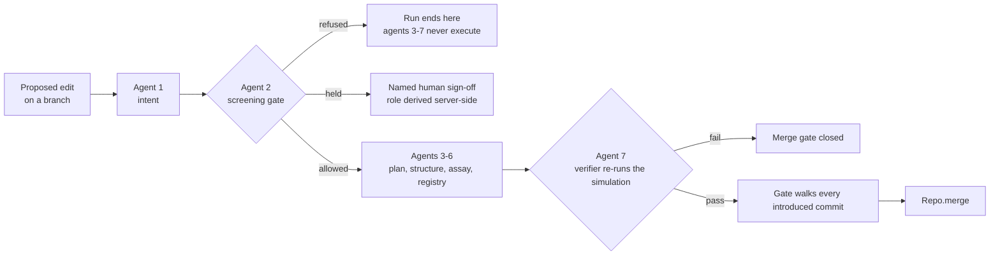

# SigmaFold — the pitch

**Git for genetic engineering.** The framing is *T3 Code, but the versioned artifact is a genome
instead of source code.*

Companions: [`../DEMO.md`](../DEMO.md) is the stage script · [`../GOALS.md`](../GOALS.md) is the
goal and live status · [`../CONVENTIONS.md`](../CONVENTIONS.md) is the house style, including the
honesty rules this document is held to · [`ARCHITECTURE.md`](./ARCHITECTURE.md) is how the pieces
fit · [`../SPEC.md`](../SPEC.md) is the contract.

---

## 1. The problem

A pre-clinical researcher proposing a therapeutic edit has **no CI**.

The proposal gets argued over in slide decks, lab notebooks and email threads. Analysis happens —
sometimes a great deal of it. But nothing comes out the other end that says:

> *this exact change, against this exact reference, passed these exact checks, and here is the
> audit trail.*

There is no artifact. There is no identity for the proposal. There is nowhere to attach *this
passed*, and nothing with the authority to refuse. Every one of those is a solved problem in
software, and the solution is so ordinary that we stopped noticing it was a solution.

## 2. The insight

**A proposed edit is a diff. A diff deserves CI.**

The mapping is the whole idea, and it is one-to-one:

| Coding tool | SigmaFold |
|---|---|
| repository | the locus under study |
| branch | a proposed genotype line |
| commit | one edit, with its check run |
| diff | the DNA / codon / amino-acid three-register diff |
| CI run | the seven-agent pipeline |
| required status check | the policy gate + the verifier |
| pull request / merge | a merge the gate can refuse |

And one bar, taken from `GOALS.md` §2: **if branch switching, check state, or any number on
screen is hardcoded rather than computed from a real module, the idea is not actually built.**
That is the line we held. Every figure in the UI is a module call.

## 3. The demo beat

One locus — human *HBB*, NCBI RefSeq **NM_000518.5** — and the textbook sickle-cell case as the
worked example: the reference allele, the single-codon substitution at CDS **codon 7** that
produces the sickle variant, and a proposed change restoring the reference codon. Standard
genetics-textbook material, used purely because it is familiar. *(CDS numbering throughout. The
legacy name for the same substitution counts from the mature protein after the initiator
methionine is cleaved — both names ship in the fixture, and nothing silently converts between
them.)*

Five moves on the `/ide` triptych — branch rail │ gene track + diff │ agent CI:

1. **The locus.** A gene track that greys out everything it does not hold sequence for, and
   renders a codon count **derived from the bases** rather than the one the fixture declares.
2. **The branch rail and the diff.** Four real branches — reference, patient baseline, two
   competing proposed edits off that baseline. One codon grid, three synchronised registers. A
   synonymous change moves the DNA register and leaves the amino-acid register alone.
3. **The simulation.** Drop oxygen tension; the genotypes diverge on screen. Seeded, headless,
   labelled illustrative where its numbers appear.
4. **The pipeline.** Seven checks in fixed order, each leaving one attributed delta in an
   append-only DAG. The screening gate sits at **position 2** — upstream of every analytical
   claim. A verifier at position 7 re-runs the simulation itself and can contradict the agents
   before it.
5. **The merge that gets refused.** Three doors, three refusals: a missing check, a failing
   check, an escalation with no human sign-off. **The merge does not happen.**

Move 5 is the pitch. The other four exist to make it mean something.

## 4. What is genuinely novel: the checks are structural

This is the part to be loud about, because it is the part that is easy to fake and we did not.

**A check that fails stops the merge in code.** It is not a warning printed next to results that
were computed anyway.

**The merge gate.** `evaluateMerge` resolves the merge base, enumerates **every commit the merge
would introduce**, and requires a completed, passing check on each one before `Repo.merge` is
called at all:

| Situation | Decision |
|---|---|
| A check failed | refused |
| A check is still pending | refused |
| A commit has **no** check run | refused |
| Escalated, with no named human sign-off recorded | **held**, not merged |
| Content conflict | refused, **and nothing is written** |

A refused merge produces no tree, no commit and no ref movement — there is no merged state
sitting behind a badge. Because the gate walks the whole introduced set, **you cannot launder a
failing commit through a later good one**: merging a branch whose history contains a refused
commit is itself refused. That property is pinned by test, not by convention.

Two hardening details worth the breath, both from the mandatory review loop:

- **Runs are held server-side and addressed by id.** The gate decides from the run the server
  computed, never from a run shape the client handed back. The client cannot forge a passing run.
- **Sign-off takes no role parameter.** The role is derived server-side from the policy's own
  verdict. A review found the bypass this closes — a client-supplied `role` field let a crafted
  payload merge a blocked branch with a forged sign-off. The parameter is now absent rather than
  validated, which is the stronger fix.

**The screening gate's position.** It runs as agent 2, before any structural or functional
analysis. Some verdicts block outright; some hold the edit for a **named human sign-off** that
nothing in the pipeline can clear. A blocked run **terminates there** — agents 3 through 7 never
execute, so there is no downstream output to print a disclaimer beside. The mechanism is the
point; what it screens for is not this document's subject.

Note what the diagram has no arrow for: no path from a refusal to any downstream agent, and no
path from agent 7 to `Repo.merge` that skips the gate.

## 5. The real engineering

**Content-addressed objects.** Three object kinds — commit, tree, blob — in one store keyed by
`oid = sha256(canonicalJson(object))`, full 64 hex, first 12 shown. `canonicalJson` sorts keys
recursively, emits no incidental whitespace, keeps array order and omits `undefined` fields. The
consequence is the one that matters: **two repositories that build the same genotype
independently derive the same id.** The suite asserts exactly that across two separate `Repo`
instances with the object literals' keys written in different orders.

Determinism has one deliberate hole and it is plugged. `commit()` would default its timestamp to
`Date.now()`, so every caller that cares passes an explicit timestamp and a merge commit derives
its own as `max(ours, theirs) + 1` rather than reading the clock. No other timestamp appears
inside hashed content. `Delta.id` is likewise content-addressed, and a delta's `createdAt` is a
**logical counter**, not wall-clock time — so a whole pipeline run replays.

**Three-way merge with genuine conflicts.** `merge(ours, theirs)` resolves the real merge base
and decides **per gene** over the union of gene symbols in base, ours and theirs. Changed on one
side: take it. Changed identically on both: take it. Changed differently on both: **conflict**,
and the function returns before writing anything. The conflict object names the gene and all
three object ids, **including the base** — without it you cannot tell which side changed what.
Nothing auto-resolves. Picking a side would be the tool inventing a scientific judgement and
burying the fact that two people disagreed.

**A best-common-ancestor `mergeBase`.** It computes the common-ancestor set, discards any
candidate dominated by another common ancestor, and picks deterministically among what remains —
so it is a *best* ancestor and it is symmetric. Not cosmetic: a dominated, too-old base makes the
three-way see a gene as changed on both sides when only one side touched it, producing a
**spurious conflict**, and it inflates the commit set the gate must walk.

**A deterministic seeded simulation.** Mulberry32, never `Math.random()`; identical seed and
params replay identically, and the suite tests that. Headless — no canvas, no DOM, no `window` —
which is what lets the assay agent and the verifier call the same `step()` the canvas renders. If
the physics lived in a React component the agent would need a second implementation, and a second
implementation is a second set of numbers to disagree about.

**An append-only audit DAG.** `add`, `get`, `all`, `history` — no update, no delete. Each delta
names the deltas it was derived from, so the record is a graph of *what was concluded from what*,
and you can walk back from any claim to the evidence under it. When the verifier disagrees with
an earlier agent it does not edit that agent's delta; it appends a verdict whose parents include
the claim it contradicts. **The record forks**, and both the optimistic claim and its refutation
stay present, attributed and ordered. Mutation would destroy exactly the disagreement an audit
trail exists to record.

**A verifier that can say no.** The assay agent runs at the requested oxygen tension, high enough
that a naive read reports preserved flow even for the sickle allele. The verifier never reads
that prose. It takes the plan, **re-runs the simulation itself** at the oxygen floor against the
reference genotype, and compares measured occlusion and sickled fraction against fixed margins.
It can fail a change the structural and assay agents approved, and its verdict records which of
them it disagreed with. SPEC §4.3 puts it bluntly: *a demo where the verifier always agrees is a
broken demo.*

**Where AI sits, and the one rule.** A model is allowed exactly three jobs — **intent parsing**,
**narration**, and a **second opinion** on screening — and the invariant is one sentence:
**AI may only narrow, never unlock.** The deterministic screen is authoritative and runs on the
raw text independently of anything a model said about it, so a prompt injection that fools a
parser cannot route around it. Verdicts combine by **maximum restriction**: a model saying
*allow* against a lexical *block* yields **block**. **A model never mints a verdict** — it
selects a label from a closed set and the verdict is read out of a frozen table, with an
unrecognised label resolving to the restrictive default. **The gate and the verifier stay
deterministic; no model is in that path.** Model output is untrusted data, parsed strictly
against a schema, never evaluated, never allowed to select a code path by name. The model is
**`gemini-4-argon`** — never a `*-flash` variant, not even as a cheap fallback, because a
reviewer must be able to tell which model produced which text, or whether any model did at all.

**Tests.** **265 passing across 22 files** on the integration branch, including property suites
on the VCS and the genome model that escalated five genuine ambiguities rather than resolving
them by invention — all five are now ratified decisions in SPEC §4.6. The convention that made
that happen is worth stating: *if the spec is silent on something a test exposes, escalate it —
do not invent policy*, and *do not weaken a test to make it pass.*

## 6. What this is not

Underselling is fine here. Overclaiming is not. Every line below is also in `CONVENTIONS.md` §7,
`GOALS.md` §6 or `SPEC.md` §4.8.

- **The simulation is illustrative and uncalibrated**, deliberately. Parameters were chosen so
  the genotypes read clearly on a projector. Not validated haemorheology, not predictive. The
  fixture says so in its own note, the limitation travels with every assay payload, and the UI
  says it where the numbers appear.
- **Structural annotations are curated textbook summaries, not predictions.** Each carries its
  own confidence and limitation field, and the UI surfaces that text. No structure prediction
  runs anywhere in this repository.
- **`mergeBase` picks the lowest oid among best common ancestors.** Deterministic and symmetric,
  **not correct in the full sense** for criss-cross histories. Git resolves that case with
  recursive merge; we do not. Documented, not hidden.
- **The screening layer is deterministic and lexical.** It over-blocks on innocent phrasing and
  can be evaded by paraphrase. It belongs *in front of* a human reviewer, **never in place of
  one.** `src/lib/safety/policy.ts` is never modified; CI fails any PR that touches it.
- **One locus**, and the running build holds sequence for the first 31 of its 147 annotated
  codons. Nothing here generalises to a genome.
- **No indel fixture**, so the diff view has no real indel to render — and `DiffRow` cannot carry
  CDS coordinates past an indel at all. It reports the alignment row, because one row cannot name
  a position in two diverged coordinate systems. SPEC §4.5 #2 forbids "fixing" that by reusing
  the row number.
- **No branch-creation control in the UI.** Branches are real and built through `lib/vcs`; the
  interface switches between them. `GOALS.md` §3 asks for create *and* switch; we have switch.
- **Still landing:** `/graph`, the three-pane app shell, the AI layer, the full reference record
  and FASTA upload, and the 3D genome view. `DEMO.md` lists them and the core run promises none
  of them.
- **No laboratory methods, reagents or protocols anywhere**, by policy. SigmaFold models edits at
  the sequence-diff level and nothing downstream of it. It cannot tell you whether a change is
  achievable in a cell and does not try.
- **The pipeline is deterministic and LLM-free.** A feature for auditability and a hard limit on
  capability: it normalises and screens, it does not reason about novel cases.
- **A hackathon prototype.** Not a clinical tool, not a biosafety control, not validated for any
  purpose.

## 7. What we'd build next

Short, and none of it overclaimed.

1. **Plan the branch's genotype, not the variant in isolation.** The planner currently resolves a
   requested variant on its own, so a composite genotype's real polymerization tendency and the
   one the verifier judges can differ. That is a live bug, not a roadmap item — it is first
   because it is the one place where the gate's verdict and the canvas can disagree.
2. **An indel fixture**, so the diff view renders a real insertion and deletion and the
   coordinate-divergence warning fires against actual data rather than a property test.
3. **`checkRunId` wired through the object model**, so a commit carries its check result by
   reference instead of the gate being handed a lookup map by the caller.
4. **Recursive merge base**, or an explicit UI surface for the criss-cross case that says
   *several ancestors are equally good, here they are, you choose.*
5. **Calibration as a first-class status.** Not a calibrated model — a model that must *declare*
   whether it is calibrated, so a check can refuse to treat an uncalibrated run as evidence.
   Today the limitation is a string that travels with the payload; it should be a field the gate
   can read.
6. **More than one locus**, which mostly means finding out which of our assumptions were really
   assumptions about having exactly one gene in the tree.

None of that changes the claim. The claim is that a proposed edit should be a diff with CI
attached, that the gate should be structural rather than advisory, and that this repository is a
working argument for both.
