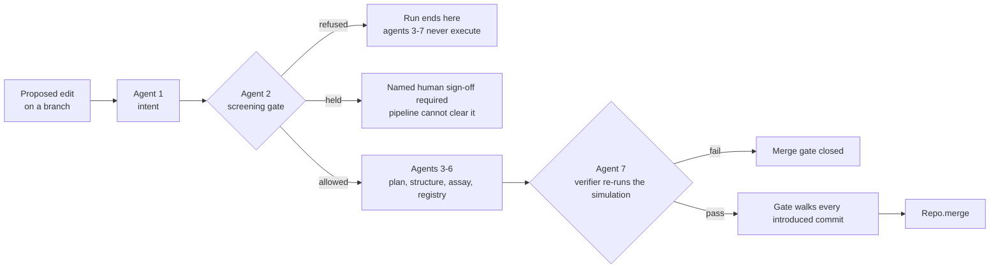

# SigmaFold — the pitch

**Version control for genome edits. Git, applied to a different artifact.**

Companion documents: [`../DEMO.md`](../DEMO.md) is the stage script,
[`ARCHITECTURE.md`](./ARCHITECTURE.md) is how the pieces fit, [`../SPEC.md`](../SPEC.md) is the
contract.

---

## 1. The problem

A researcher proposing a change to a gene has **no CI**.

The proposal gets argued over in slide decks, lab notebooks and email threads. Analysis happens —
sometimes a great deal of it. But nothing comes out the other end that says:

> *this exact change, against this exact reference, passed these exact checks, with this audit
> trail.*

There is no artifact. There is no identity for the proposal. There is nowhere to attach *this
passed*, and nothing that can refuse to let a change through. Every one of those is a solved
problem in software, and the solution is so ordinary that we stopped noticing it was a solution.

## 2. The insight

**A proposed edit is a diff. A diff deserves CI.**

That is the whole idea, and it is worth being precise about why it is not just an analogy:

- A genotype is **content**. Content can be addressed by its hash, which gives a proposal a
  **name you can cite**.
- A change has a **parent**, an **author** and a **message**. That makes it a commit.
- Two people can change the same gene in two different ways. That is a **merge conflict**, and
  it has a correct answer: *refuse, and hand it to a human*.
- A set of checks either passed or did not. That is a **check run**, and it is the thing you
  gate a merge on.

Edit review already has all four of those problems. It currently solves them in prose.

## 3. The demo beat

One locus — human *HBB*, NCBI RefSeq **NM_000518.5** — and the textbook sickle-cell case as the
worked example: the reference allele, the single-codon substitution at CDS **codon 7** that
produces the sickle variant, and a proposed change that restores the reference codon. Standard
genetics-textbook material, used purely because it is familiar.

**Five moves, three minutes:**

1. **The locus.** A gene track that greys out everything it does not hold sequence for, rather
   than padding it.
2. **The branches and the diff.** Three real branches; one codon grid in three synchronised
   registers — DNA, codon, amino acid. One changed row.
3. **The simulation.** Drop oxygen tension and the genotypes diverge on screen. Seeded,
   headless, and labelled illustrative where the numbers appear.
4. **The pipeline.** Seven checks resolve in fixed order, each leaving one attributed delta in an
   append-only DAG. The screening gate sits at **position 2** — upstream of every analytical
   claim. A verifier at position 7 re-runs the simulation itself and can contradict the agents
   before it.
5. **The merge that gets refused.** A failing check and the merge **does not happen**.

Move 5 is the pitch. The other four exist to make it mean something.

## 4. What is genuinely novel: the checks are structural

This is the part to be loud about, because it is the part that is easy to fake and we did not.

**A check that fails stops the merge in code.** It is not a warning printed next to results that
were computed anyway.

Two places that shows up:

**The merge gate.** `evaluateMerge` resolves the merge base, enumerates **every commit the merge
would introduce**, and requires a completed, passing check on each one before `Repo.merge` is
called at all. It fails closed in three directions, not one:

| Situation | Decision |
|---|---|
| A check failed | refused |
| A check is still pending | refused |
| A commit has **no** check run | refused |
| An escalated check with no named human sign-off recorded | **held**, not merged |
| Content conflict | refused, **and nothing is written** |

A refused merge produces no tree, no commit and no ref movement. And because the gate walks the
whole introduced set, **you cannot launder a failing commit through a later good one** — merging
a branch whose history contains a refused commit is itself refused. That property is pinned by
test, not by convention.

**The screening gate's position.** It runs as agent 2, before any structural or functional
analysis. Some verdicts block outright; some hold the edit for a **named human sign-off**, which
nothing in the pipeline can clear. A blocked run **terminates there** — agents 3 through 7 never
execute, so there is no downstream output to print a disclaimer beside. The mechanism is the
point; what it screens for is not this document's subject.

Note what the diagram has no arrow for: there is no path from a refusal to any downstream agent,
and no path from agent 7 to `Repo.merge` that skips the gate.

## 5. The real engineering

Verified in code in this checkout, not aspirational.

**Content-addressed objects.** Three object kinds — commit, tree, blob — in one store keyed by
`oid = sha256(canonicalJson(object))`, full 64 hex, first 12 shown in the UI. `canonicalJson`
sorts keys recursively, emits no incidental whitespace, keeps array order and omits `undefined`
fields. The consequence is the one that matters: **two repositories that build the same genotype
independently derive the same id.** The suite asserts exactly that across two separate `Repo`
instances with the object literals' keys written in different orders.

Determinism has one deliberate hole and it is plugged. `commit()` would default its timestamp to
`Date.now()`, so every caller that cares passes an explicit timestamp, and a merge commit derives
its own as `max(ours, theirs) + 1` rather than reading the clock. No other timestamp appears
inside hashed content. `Delta.id` is likewise content-addressed, and `createdAt` on a delta is a
**logical counter**, not wall-clock time — so a whole pipeline run is reproducible.

**Three-way merge with genuine conflicts.** `merge(ours, theirs)` resolves the real merge base
and decides **per gene** over the union of gene symbols in base, ours and theirs. Changed on one
side: take it. Changed identically on both: take it. Changed differently on both: **conflict**,
and the function returns before writing anything — no tree, no commit, no ref movement. The
conflict object names the gene and all three object ids, including the base, because without the
base you cannot tell which side changed what. Nothing auto-resolves. Picking a side would be the
tool inventing a scientific judgement it has no basis for, and burying the fact that two people
disagreed.

**A best-common-ancestor `mergeBase`.** It computes the common-ancestor set, discards any
candidate dominated by another common ancestor, and picks deterministically among what remains —
so it is a *best* ancestor and it is symmetric. This is not cosmetic: a dominated, too-old base
makes the three-way see a gene as changed on both sides when only one side touched it, producing
a **spurious conflict**, and it inflates the commit set the merge gate has to walk.

**A deterministic seeded simulation.** Mulberry32, never `Math.random()`; identical seed and
params replay identically. Headless — no canvas, no DOM, no `window` — which is what lets the
assay agent and the verifier call the same `step()` the canvas renders. If the physics lived in a
React component, the agent would need a second implementation, and a second implementation is a
second set of numbers to disagree about.

**An append-only audit DAG.** `add`, `get`, `all`, `history` — no update, no delete. Each delta
names the deltas it was derived from, so the record is a graph of *what was concluded from what*,
and you can walk back from any claim to the evidence under it. When the verifier disagrees with
an earlier agent, it does not edit that agent's delta; it appends a verdict whose parents include
the claim it contradicts. **The record forks**, and both the optimistic claim and its refutation
stay present, attributed and ordered. Mutation would destroy exactly the disagreement an audit
trail exists to record.

**A verifier that can say no.** The assay agent runs at the requested oxygen tension, which is
high enough that a naive read reports preserved flow even for the sickle allele. The verifier
never reads that prose. It takes the plan, **re-runs the simulation itself** at the oxygen floor
against the reference genotype, and compares measured occlusion and sickled fraction against
fixed margins. It can fail a change the structural and assay agents approved, and its verdict
records which of them it disagreed with. SPEC §4.3 puts it bluntly: *a demo where the verifier
always agrees is a broken demo.*

**~220 tests.** **217 tests across 19 files** in this checkout, including property tests on the
VCS and the genome model that escalated five genuine ambiguities rather than resolving them by
invention — all five are now ratified decisions in SPEC §4.6.

## 6. What this is not

Underselling is fine here. Overclaiming is not.

- **The simulation is illustrative and uncalibrated, deliberately.** Parameters were chosen so
  the genotypes read clearly on a projector. Not validated haemorheology, not predictive. The
  fixture says so in its own note, the limitation string travels with every assay payload, and
  the UI says it where the numbers appear.
- **Structural annotations are curated textbook prose**, each carrying its own confidence and
  limitation field. No structure prediction runs anywhere in this repository.
- **The screening gate is auditable, not robust.** Deterministic and re-derivable by hand, which
  is also why it over-blocks on innocent phrasing and can be evaded by paraphrase. It belongs in
  front of a human reviewer, never in place of one.
- **One locus.** Nothing here generalises to a genome.
- **No indel fixture**, so the diff view has no real indel to render — and `DiffRow` cannot carry
  CDS coordinates past an indel at all. It reports the alignment row, because one row cannot name
  a position in two diverged coordinate systems. SPEC §4.5 #2 forbids "fixing" that by reusing
  the row number.
- **`mergeBase` does not do recursive merge.** On a criss-cross history with several equally good
  ancestors it picks deterministically. That is symmetric and reproducible, not correct in the
  full sense.
- **No branch-creation control in the UI.** Branches are real and created through `lib/vcs`; the
  interface switches between them.
- **No laboratory methods, reagents or protocols anywhere**, by policy. SigmaFold models edits at
  the sequence-diff level and nothing downstream of it. It cannot tell you whether a change is
  achievable in a cell and does not try.
- **The pipeline is deterministic and LLM-free.** A feature for auditability and a hard limit on
  capability: it normalises and screens, it does not reason about novel cases.
- **A hackathon prototype.** Not a clinical tool, not a biosafety control, not validated for any
  purpose.

## 7. What we'd build next

Short, and none of it overclaimed.

1. **An indel fixture**, so the diff view renders a real insertion and deletion and the
   coordinate-divergence warning fires against actual data rather than a property test.
2. **`checkRunId` wired through the object model**, so a commit carries its check result by
   reference instead of the gate being handed a lookup map by the caller.
3. **Recursive merge base**, or an explicit UI surface for the criss-cross case that says *several
   ancestors are equally good, here they are, you choose*.
4. **Calibration as a first-class status.** Not a calibrated model — a model that has to declare
   whether it is calibrated, so a check can refuse to treat an uncalibrated run as evidence.
   Today the limitation is a string that travels with the payload; it should be a field the gate
   can read.
5. **More than one locus**, which mostly means finding out which of our assumptions were really
   assumptions about having exactly one gene in the tree.

None of that changes the claim. The claim is that a proposed edit should be a diff with CI
attached, that the gate should be structural, and that this repository is a working argument for
both.
